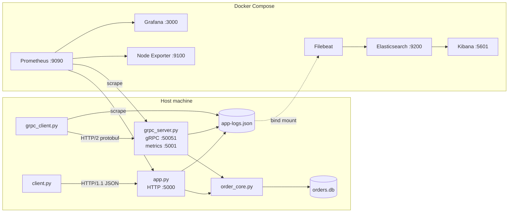

# esd-assignment2
Enterprise Software Development — Assignment 2: HTTP APIs, gRPC, and Metrics

# Fast-Food API — HTTP + gRPC

This project extends the Assignment 1 observability stack. The Flask HTTP API is hardened with validation, consistent JSON errors, idempotency, rate limiting and an OpenAPI contract. A second process serves the same order operation over **gRPC**. Both servers share one business-rules module (`order_core.py`) and one SQLite store, write to the same JSON log file, and are scraped by the same Prometheus, so they can be compared side by side in Grafana and Kibana.

📄 **Full write-up:** [`Report.md`](./Report.md) — REST table, OpenAPI, before/after, reliability tests, call paths, HTTP vs gRPC statuses, metric audit and dashboard evidence.

---

## Architecture



The Python servers run **on the host**, not in Docker. Prometheus reaches them through `host.docker.internal` (see `extra_hosts` in `docker-compose.yml`). Filebeat reads `app-logs.json` through a bind mount.

## Repository structure

```text
esd/
├── app.py                  # HTTP API: POST /order, GET /metrics
├── grpc_server.py          # gRPC OrderService (+ metrics on :5001)
├── order_core.py           # shared business rules + SQLite store (both servers)
├── order.proto             # RPC + message definitions
├── order_pb2.py            # generated - do not edit
├── order_pb2_grpc.py       # generated - do not edit
├── openapi.yaml            # OpenAPI 3.0.3 contract for the HTTP API
├── client.py               # HTTP caller: timeout, retry/backoff, circuit breaker
├── grpc_client.py          # gRPC caller: input, deadline, trace id
├── traffic_generator.py    # repeatable success + failure traffic for Grafana
├── tests/                  # pytest: HTTP, gRPC, OpenAPI contract (20 tests)
├── dashboards/
│   └── fast_food_api_a2.json
├── screenshots/            # evidence used in Report.md
├── prometheus.yml          # scrape jobs: fast-food-api, grpc-food-api, node-exporter
├── filebeat.yml
├── docker-compose.yml
├── requirements.txt
├── app-logs.json           # shared log file (empty in the repo)
├── Report.md
└── README.md
```

`orders.db` is created automatically on first run and is not part of the repository.

## Prerequisites

- Docker Desktop (with Docker Compose)
- Python 3.9+ (commands use the Windows `py` launcher; use `python` on macOS/Linux)

## Run

Run everything from the `esd` folder, so all scripts share the `app-logs.json` and `orders.db` that the rest of the stack expects.

```powershell
# 1. Install dependencies
py -m pip install -r requirements.txt

# 2. Make sure the log file exists BEFORE Docker starts
#    (otherwise Docker creates a folder called app-logs.json)
if (-not (Test-Path app-logs.json)) { New-Item app-logs.json -ItemType File }

# 3. Start the observability stack
docker-compose up -d

# 4. Terminal 1 - HTTP API on :5000
py app.py

# 5. Terminal 2 - gRPC service on :50051, metrics on :5001
py grpc_server.py
```

Check http://localhost:9090/targets — `fast-food-api`, `grpc-food-api` and `node-exporter` should all be **UP**.

**Regenerate the gRPC code** (only needed if `order.proto` changes):

```powershell
py -m grpc_tools.protoc -I. --python_out=. --grpc_python_out=. order.proto
```

## Test

Run these from a third terminal in the `esd` folder.

| Command | Needs servers? | Shows |
|---|---|---|
| `py -m pytest -v tests` | No | 20 tests: valid / invalid / repeated requests, 429, JSON errors, metric labels, gRPC statuses, shared store across protocols, OpenAPI contract |
| `py client.py demo` | No (starts its own server on :5050) | Caller: success → retry with backoff → breaker OPEN → blocked → HALF-OPEN → CLOSED |
| `py client.py ratelimit` | `app.py` | 7 calls at once → 5 × `200`, 2 × `429` + `Retry-After`, then accepted again |
| `py client.py order --key my-key --timeout 3` | `app.py` | Timeout → retry → same order returned (idempotency) |
| `py grpc_client.py --demo` | `grpc_server.py` | gRPC `OK`, safe repeat, `DEADLINE_EXCEEDED`, `INVALID_ARGUMENT` |
| `py grpc_client.py --key my-key --deadline 15` | `grpc_server.py` | One gRPC call with your own input |
| `py traffic_generator.py --rounds 5` | Both | Repeatable success + failure traffic for the dashboard |

All demo scripts use fresh keys on every run, so they give the same results every time.

**Manual HTTP checks**

```powershell
# Invalid input -> 400 {"error":"idempotency_key is required"}
curl.exe -i -X POST http://localhost:5000/order -H "Content-Type: application/json" -d "{}"

# Valid, then repeated with the same key -> same order_id, "safe repeat"
Invoke-RestMethod -Uri http://localhost:5000/order -Method POST -ContentType "application/json" -Body '{"idempotency_key":"manual-001"}'
Invoke-RestMethod -Uri http://localhost:5000/order -Method POST -ContentType "application/json" -Body '{"idempotency_key":"manual-001"}'
```

`POST /order` allows 5 requests per 10 seconds across all callers. If you get `429`, wait 10 seconds.

**Reset stored orders** (optional):

```powershell
py order_core.py reset
```

## Services

| Service | URL | Credentials |
|---|---|---|
| HTTP API | http://localhost:5000/order | — |
| HTTP metrics | http://localhost:5000/metrics | — |
| gRPC service | `localhost:50051` | insecure channel |
| gRPC metrics | http://localhost:5001/metrics | — |
| Prometheus | http://localhost:9090 | — |
| Grafana | http://localhost:3000 | `admin` / `admin` |
| Elasticsearch | http://localhost:9200 | security disabled |
| Kibana | http://localhost:5601 | — |

## Grafana dashboard

1. Open http://localhost:3000 and log in.
2. **Connections → Data sources → Add data source → Prometheus.** Set the URL to `http://prometheus:9090` (the Compose service name, not `localhost`), then **Save & test**.
3. **Dashboards → New → Import → Upload dashboard JSON file** → `dashboards/fast_food_api_a2.json`.
4. Pick your Prometheus data source when asked, then **Import**.
5. Run `py traffic_generator.py --rounds 5`. Set the time range to *Last 15 minutes* and refresh to *5s*.

The 8 panels are:

- HTTP calls by status
- gRPC calls by code
- Error rate
- Request duration p50/p95
- Cook time p50/p95
- In-flight orders
- Orders placed
- Idempotent replays and 429s

## Kibana

1. Open http://localhost:5601 → **Stack Management → Data Views → Create data view**, with pattern `filebeat-*` and timestamp field `@timestamp`.
2. Go to **Discover** and add the columns `message`, `app_service`, `request_id`, `trace_id` and `grpc_code`.

| Find | KQL |
|---|---|
| One call across client and server | `trace_id : "<id printed by grpc_client.py>"` |
| One order's trail | `request_id : "ord_xxxxxxxx"` |
| Retries answered from the store | `message : "Duplicate order prevented"` |
| Rate-limited calls | `message : "Rate limit exceeded"` |
| gRPC failures | `grpc_code : "DEADLINE_EXCEEDED" or grpc_code : "INVALID_ARGUMENT"` |
| One server only | `app_service : "food-api"` or `app_service : "grpc-food-api"` |

## Common problems

| Problem | Fix |
|---|---|
| A target is DOWN in Prometheus | Start the matching server: `app.py` for `fast-food-api`, `grpc_server.py` for `grpc-food-api` |
| Grafana "Connection was reset" / "Empty reply" | Wait 60 s after starting. If it persists, reset its data: `docker-compose stop grafana`, `docker-compose rm -f grafana`, `docker volume rm esd_grafana_data`, `docker-compose up -d grafana` |
| Grafana data source "invalid URL" | Type `http://prometheus:9090` into the URL box by hand (the grey text is only a placeholder) |
| Dashboard panels show "No data" | Run `py traffic_generator.py`, wait 30 s; check the targets are UP |
| Every HTTP call returns `429` | The limit is global; wait 10 seconds |
| Kibana shows no new logs | Check `Get-Content app-logs.json -Tail 3`; if lines exist, run `docker-compose restart filebeat` |
| Calls to `localhost` take about 2 s longer on Windows | `localhost` tries IPv6 first, then IPv4; this is client-side and harmless |
| `RuntimeError: The grpc package installed is at version …` | `py -m pip install -U grpcio grpcio-tools`, or regenerate the code |

## Cleaning up

```powershell
docker-compose down -v     # stop containers and delete named volumes
del app-logs.json
del orders.db
```

## Author

[Your Name]
