# Assignment 2 — HTTP APIs, gRPC, and Metrics

**Fast-Food API: a hardened HTTP contract, a gRPC service on the same business rules, and protocol-level metrics**

Enterprise Software Development, Fall 2026 — extends the Assignment 1 project.

All outputs in this report are from runs on the development machine (Windows, Python 3.14.5) on 20 October 2026. Screenshots are in [`screenshots/`](./screenshots).

---

## Contents

- [Overview](#overview)
- [Part A — Improving the HTTP API](#part-a--improving-the-http-api)
- [Part B — gRPC service](#part-b--grpc-service)
- [Part C — Extending the metrics](#part-c--extending-the-metrics)
- [References and reused work](#references-and-reused-work)

---

## Overview

Assignment 1 had one Flask endpoint, `POST /order`, that accepted any request, cooked an order for 5–10 seconds, and returned an order ID. Assignment 2 makes three changes:

| Part | Change |
|---|---|
| A | `POST /order` now validates input, returns consistent JSON errors, is idempotent (a retry never cooks twice), is rate limited, and is described by an OpenAPI contract. A Python caller adds a timeout, retries and a circuit breaker. |
| B | The same "place an order" operation is served by a second process over gRPC. Both front doors use one shared module (`order_core.py`) and one store (SQLite `orders.db`). |
| C | New metrics count calls by method and status and measure end-to-end duration for both protocols, shown side by side in Grafana. |

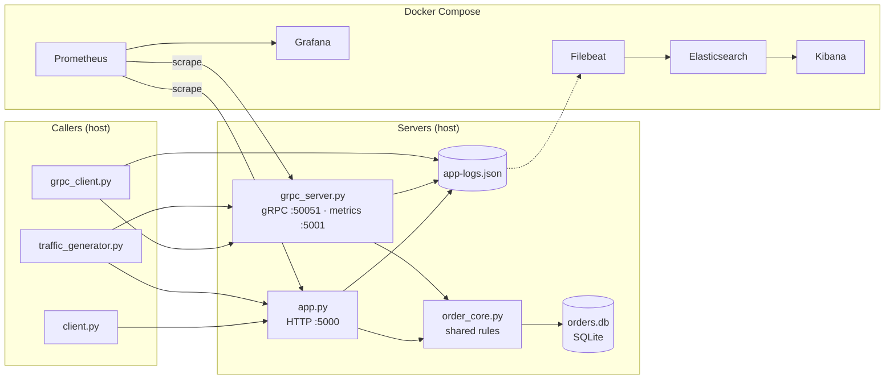

---

## Part A — Improving the HTTP API

### A.1 REST constraints

| Constraint | Plain-language meaning | In this API |
|---|---|---|
| Client–server | The caller and the service are separate programs that only share the interface, so each can change independently. | **Applied.** `client.py`, `traffic_generator.py` and the tests call `app.py` over HTTP; none of them import its code. |
| Stateless | Each request carries everything the server needs; the server keeps no per-client session between requests. | **Applied.** Every `POST /order` carries its own `idempotency_key` (and optionally `X-Request-ID`). The server stores *orders* (resource state) but no login or per-connection session. |
| Cacheable | Responses say whether, and for how long, they may be reused. | **Not applied.** Orders are one-off, real-time actions, so no `Cache-Control` headers are sent. (Idempotent replay is a server-side duplicate guard, not HTTP caching.) |
| Uniform interface | Resources, methods, representations and status codes follow shared conventions. | **Applied.** `POST /order` creates an order; requests and responses are JSON; status codes are standard (`200`, `400`, `404`, `405`, `429`, `500`); every error has the same `{"error": "..."}` body. |
| Layered system | A caller cannot tell whether it talks to the server directly or through intermediaries. | **Applied.** The caller only knows a base URL; Flask on `localhost:5000` could be put behind a proxy or load balancer without changing the caller. |
| Code on demand *(optional)* | The server may send executable code for the client to run. | **Not applied.** The API returns JSON data only. |

### A.2 OpenAPI Specification

**Purpose.** The OpenAPI Specification (formerly Swagger) is an industry-standard, machine-readable blueprint for RESTful web services. It defines exactly which endpoints exist, what inputs they require, and which success or error codes they return. Because clients and servers share one strict contract, developers can generate code, documentation and tests directly from the file.

**Our spec.** [`openapi.yaml`](./openapi.yaml) (OpenAPI 3.0.3, API version 2.1.0) documents `POST /order`:

| Element | Contract |
|---|---|
| Server | `http://localhost:5000` |
| Request header | Optional `X-Request-ID` (trace ID, max 64 chars), echoed back in the response |
| Request body | Required JSON object; `idempotency_key` string, 1–100 characters of `A-Z a-z 0-9 . _ : -` |
| `200` | `{status, order_id}` — status is `Order ready!` (new) or `Order already processed (safe repeat)` |
| `400` | `Error` — body is not a JSON object, or the key is missing or invalid |
| `429` | `Error` + `Retry-After` header (integer seconds, at least 1) |
| `500` | `Error` |

All errors share one schema (`components/schemas/Error`). `GET /metrics` is deliberately left out of the spec: it is a monitoring endpoint, not part of the application API.

**Use — testing the endpoint against the spec.** [`tests/test_openapi_contract.py`](./tests/test_openapi_contract.py) loads `openapi.yaml` and, for real responses from the API, checks that:

- the status code is one the spec documents,
- the JSON body validates against the documented schema,
- the documented headers (e.g. `Retry-After` on `429`, `X-Request-ID` on `200`) are present.

It covers a new order and a repeat (`200`), invalid input (`400`) and rate limiting (`429`), and also checks that the request example in the spec matches the request schema. All four contract tests pass (screenshot in A.5).

### A.3 User task — placing an order: before and after

| | A1 (before) | A2 (after) |
|---|---|---|
| **Endpoint** | `POST /order` | `POST /order` |
| **Problem** | Accepted bodiless requests with no validation. A client that retried after a dropped response cooked a second order. Nothing limited request volume. Unknown routes and server errors returned HTML pages. | — |
| **Change** | — | Requires a JSON object with a valid `idempotency_key`. Stores `key → order_id` in a shared store *before* cooking, so retries get the original order back. Limits calls to 5 per 10 s with `429` + `Retry-After`. Returns every error as `{"error": "..."}`. Accepts and echoes `X-Request-ID` for log correlation. |
| **Reason** | — | Makes retries safe (idempotency), protects the kitchen from overload (rate limiting), and gives callers machine-readable errors they can act on. |

**Other endpoints**

| Endpoint | Decision |
|---|---|
| `GET /metrics` | **Left alone.** Not rate limited, not validated, and excluded from `http_requests_total`, so Prometheus scrapes never count as API traffic. |
| Any unknown route / wrong method | **Changed.** Now return JSON `404` / `405` instead of Flask's HTML pages (consistent error format). |

**Callers updated.** The A1 PowerShell loop (`curl.exe -X POST` with no body) now gets `400`, so it was replaced by:

- `client.py` — the resilient caller (A.7),
- `traffic_generator.py` — dashboard load,
- `tests/` — automated tests.

### A.4 Practices applied

**Validation and consistent errors.** The body must be a JSON object, and `idempotency_key` must be a 1–100 character string of safe characters (`order_core.validate_key`). Any wrong type (number, list, object) is a `400`. In A1-style code a non-string key crashed with an HTML `500`; that case is now covered by a test. Error handlers in `app.py` turn every other failure (`404`, `405`, `500`) into the same JSON shape.

The invalid-input request returns a JSON `400` and still carries a trace ID:

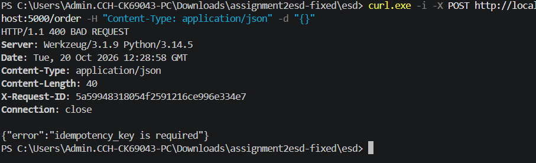

**Idempotency (safe repeats).** Placing an order is not naturally idempotent, because each call cooks food. The caller therefore sends an `idempotency_key`.

1. The server claims the key with one atomic SQLite statement (`INSERT OR IGNORE`) *before* cooking.
2. If the key is new, it generates an `order_id` (`ord_<8 hex>`), cooks, then marks the order `ready`.
3. If the key already exists — including while the first request is still cooking — the server returns `200` with the stored `order_id`, the status `Order already processed (safe repeat)`, and cooks nothing.

The store is shared by the HTTP and gRPC servers and survives restarts.

**Rate limiting.**

| Question | Answer |
|---|---|
| Limit | 5 requests per 10-second fixed window on `POST /order` |
| Who shares it | All callers together: one global, thread-safe counter for this single Flask instance (not per client or IP). Every `POST /order` counts, including invalid and repeated ones, because the check runs first. `GET /metrics` is not limited. |
| When calls are allowed again | When the current 10 s window ends. `Retry-After` gives the remaining seconds, rounded **up** and never less than 1, so a caller that waits that long is always inside the next window. |

### A.5 Tests: valid, invalid and repeated requests

`py -m pytest -v tests` runs 20 automated tests with a temporary database and a shortened cook time. HTTP tests use Flask's test client; gRPC tests start the real gRPC server in-process.

| Required case | Test |
|---|---|
| Valid request | `test_valid_request_places_order` — `200`, `Order ready!`, ID `ord_…` |
| Invalid input | `test_missing_key_is_400`, `test_wrong_key_type_is_400_not_500`, `test_key_with_bad_characters_is_400`, `test_missing_or_non_json_body_is_400` |
| Repeated request | `test_repeated_request_returns_same_order_and_cooks_once` — same `order_id`, replay status, and `orders_placed_total` rises by exactly 1 |
| Rate limiting | `test_rate_limit_returns_429_with_retry_after` |
| Error format | `test_errors_are_json_everywhere` (`404`, `405`) |
| Metric labels | `test_metrics_have_status_labels_and_no_id_labels` |

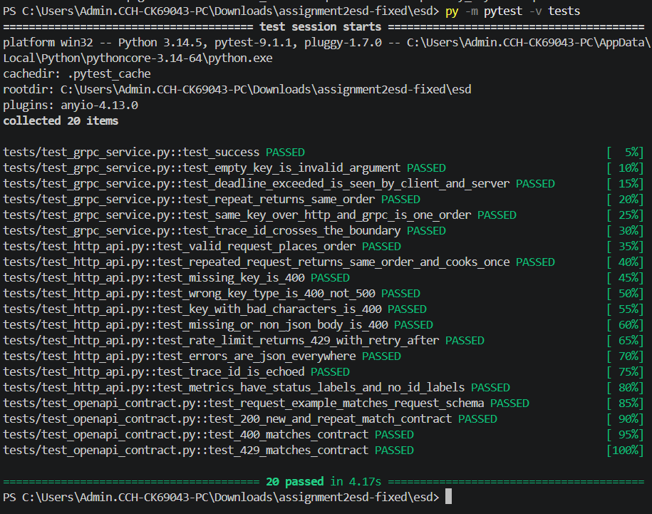

### A.6 Rate-limit test

`py client.py ratelimit` sends 7 requests to `POST /order` at the same moment:

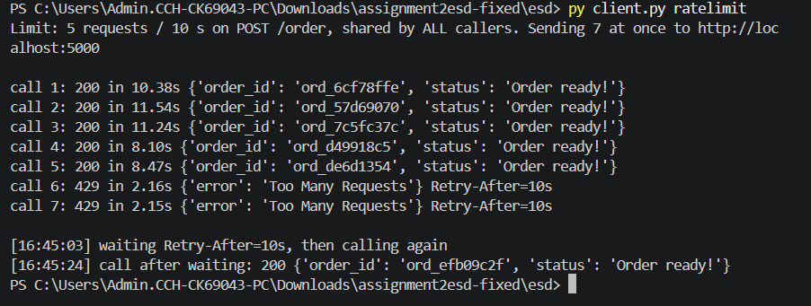

| Calls | Result |
|---|---|
| 1–5 | Accepted — `200` after cooking (8.1–11.5 s) |
| 6–7 | Rejected immediately — `429 {"error": "Too Many Requests"}` with `Retry-After=10` |
| After waiting 10 s | Accepted — `200` (`ord_efb09c2f`) |

`Retry-After` is 10 because all 7 calls arrived at the start of a new window.

*Note on timings:* on Windows, `requests` first tries `localhost` over IPv6 (`::1`) and then falls back to IPv4. This adds about 2 seconds to each connection, which is why the "instant" `429`s took 2.15 s on the client. The server rejected them without delay.

### A.7 Python caller: timeout, retry, circuit breaker

`client.py` acts as another service calling `POST /order` (`OrderClient` + `CircuitBreaker` classes).

| Setting | Value |
|---|---|
| Timeout | 12 s per attempt (longer than the 10 s maximum cook time, so a healthy call fits) |
| Retry limit | 3 attempts per call (1 try + 2 retries) |
| Backoff | Exponential: 0.5 s, then 1 s (no wait after the last attempt) |
| Retried on | Timeout, connection error, `502`/`503`/`504` — transient failures only. `4xx` is never retried. `429` is reported, not retried. |
| Why retrying is safe | Every attempt sends the same `idempotency_key`, so the server can never cook twice. |
| Breaker opens | After 2 consecutive failed calls (a call fails when all attempts fail) |
| Recovery period | 10 s open, then **half-open**: one trial call. Success → closed; failure → open again. |

**Demo with a real server failure.** `py client.py demo` starts its own copy of `app.py` on port 5050, then stops the process to cause a genuine outage, then restarts it. Your main server on port 5000 is not touched.

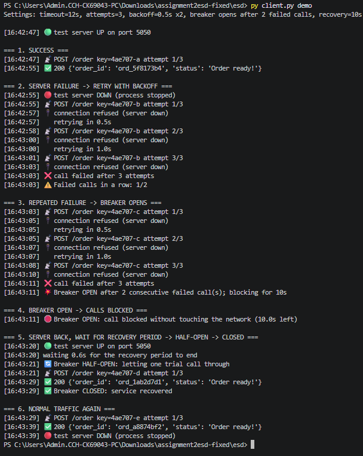

| Required behaviour | Evidence (timestamps from the screenshot) |
|---|---|
| Succeeding | 16:42:47 → 16:42:55: `200`, `ord_5f8173b4` |
| Retrying a failure | 16:42:55 server stopped; key `-b` tried 3 times with 0.5 s and 1 s backoff; call failed → "Failed calls in a row: 1/2" |
| Breaker opening | Key `-c` fails the same way; 16:43:11 "Breaker OPEN after 2 consecutive failed call(s); blocking for 10s" |
| Blocking while open | 16:43:11 key `-d` blocked without touching the network (10.0 s left) |
| Recovering | 16:43:20 server back; 16:43:21 HALF-OPEN trial; 16:43:29 `200` (`ord_1ab2d7d1`) → "Breaker CLOSED: service recovered"; 16:43:39 normal call succeeds |

**Timeout + idempotency.** `py client.py order --key timeout-test-1 --timeout 3` uses a 3 s timeout, shorter than the cook time. The first attempt times out, and the retry carries the same key. The server is still cooking the original order, so it answers immediately with that order instead of cooking a second one:

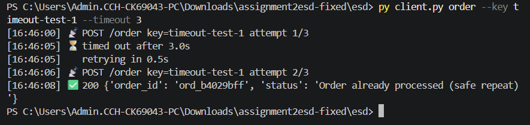

---

## Part B — gRPC service

### B.1 Contract and generated code

The operation taken from the user task is **place an order**, defined in [`order.proto`](./order.proto) as a unary RPC. Unary fits because there is one order in and one confirmation out; nothing needs streaming.

```proto
syntax = "proto3";
package fastfood;

service OrderService {
    rpc PlaceOrder (OrderRequest) returns (OrderResponse) {}
}

message OrderRequest  { string idempotency_key = 1; }
message OrderResponse { string status = 1; string order_id = 2; }
```

**Generation command**

```powershell
py -m grpc_tools.protoc -I. --python_out=. --grpc_python_out=. order.proto
```

| Generated file | Contains |
|---|---|
| `order_pb2.py` | Message classes `OrderRequest`, `OrderResponse` |
| `order_pb2_grpc.py` | `OrderServiceStub` (client), `OrderServiceServicer` and `add_OrderServiceServicer_to_server` (server) |

### B.2 Server: same business rules, same source of truth

`grpc_server.py` is a separate process: gRPC on `:50051` (10 worker threads) and Prometheus metrics on `:5001`. `OrderServiceServicer.PlaceOrder` does **not** call the HTTP API. Both servers call the same function, `order_core.place_order()`, which owns every business rule:

| Rule | Where |
|---|---|
| Key validation | `order_core.validate_key` |
| Idempotency / duplicate detection | `order_core._reserve` (atomic `INSERT OR IGNORE`) |
| Order ID format | `order_core._reserve` |
| Kitchen simulation and completion | `order_core.place_order` |
| Store | SQLite `orders.db`, one `orders` table used by both processes |

Each server only translates between its protocol and the core:

| Outcome | HTTP | gRPC |
|---|---|---|
| Invalid input | `400` | `INVALID_ARGUMENT` |
| Success / replay | `200` + JSON | `OK` + `OrderResponse` |
| Trace ID | `X-Request-ID` header | `x-request-id` metadata |

The test `test_same_key_over_http_and_grpc_is_one_order` proves the shared source of truth: a key used first over HTTP returns the *same* `order_id` when sent over gRPC, as a safe repeat.

### B.3 Client

`grpc_client.py` calls the service directly through the generated stub.

| Feature | How |
|---|---|
| Accepts input | `--key`, `--deadline`, `--target` |
| Deadline | Passed as `timeout=` on every call |
| Reports results | Prints status, order ID and elapsed time |
| Reports errors | Prints the gRPC status code and details |
| Trace correlation | Sends `x-request-id` metadata, prints the trace ID the server echoes back, and logs start/finish to `app-logs.json` |
| Repeatable demo | `--demo` uses fresh keys on every run |

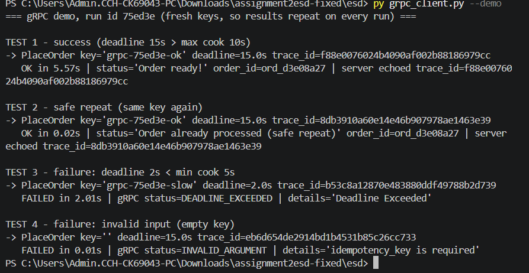

| Test | Deadline | Result |
|---|---|---|
| 1 — success | 15 s | `OK` in 5.57 s, `ord_d3e08a27`, trace ID echoed by the server |
| 2 — same key again | 15 s | `OK` in 0.02 s, same `ord_d3e08a27`, `safe repeat` |
| 3 — too slow | 2 s | `DEADLINE_EXCEEDED` after 2.01 s |
| 4 — empty key | 15 s | `INVALID_ARGUMENT`: `idempotency_key is required`, in 0.01 s |

### B.4 Success and failure through both versions

| Case | HTTP `POST /order` | gRPC `PlaceOrder` |
|---|---|---|
| Success | `200 OK` + `{"order_id": "ord_5f8173b4", "status": "Order ready!"}` (screenshot 01) | `OK` + `OrderResponse(status="Order ready!", order_id="ord_d3e08a27")` (screenshot 04) |
| Failure — invalid input | `400 BAD REQUEST` + `{"error": "idempotency_key is required"}` (screenshot 08) | `INVALID_ARGUMENT`, details `idempotency_key is required` (screenshot 04) |
| Failure — too slow for the caller | Client `Timeout` exception; **no HTTP status** is received (screenshot 03) | `DEADLINE_EXCEEDED` (screenshot 04) |

**Explaining the statuses.**

- **HTTP** puts the outcome in the response status line (`400 BAD REQUEST`). Codes such as `408` or `504` exist for slowness, but a server or gateway sends them. In our timeout test the *client* gave up first, so no status code ever arrived.
- **gRPC** runs over HTTP/2 but does not use HTTP status codes for application results. The HTTP/2 `:status` is normally `200`, and the real outcome is a canonical gRPC code in the `grpc-status` trailer (`INVALID_ARGUMENT` = 3).
- **Deadlines** are sent to the server in the `grpc-timeout` header. When the deadline passes, the client cancels the call and raises `DEADLINE_EXCEEDED` (code 4) itself. The server also notices — `context.is_active()` becomes false — and records `DEADLINE_EXCEEDED` in its own metrics. Because the key was stored before cooking, a retry with the same key gets the order back.

| Meaning | HTTP | gRPC |
|---|---|---|
| Success | 200 | OK (0) |
| Bad input | 400 | INVALID_ARGUMENT (3) |
| Too slow | 504 (from a gateway) / client timeout | DEADLINE_EXCEEDED (4) |
| Rate limited | 429 | RESOURCE_EXHAUSTED (8) — not used; rate limiting applies to the HTTP endpoint only |

### B.5 Call paths

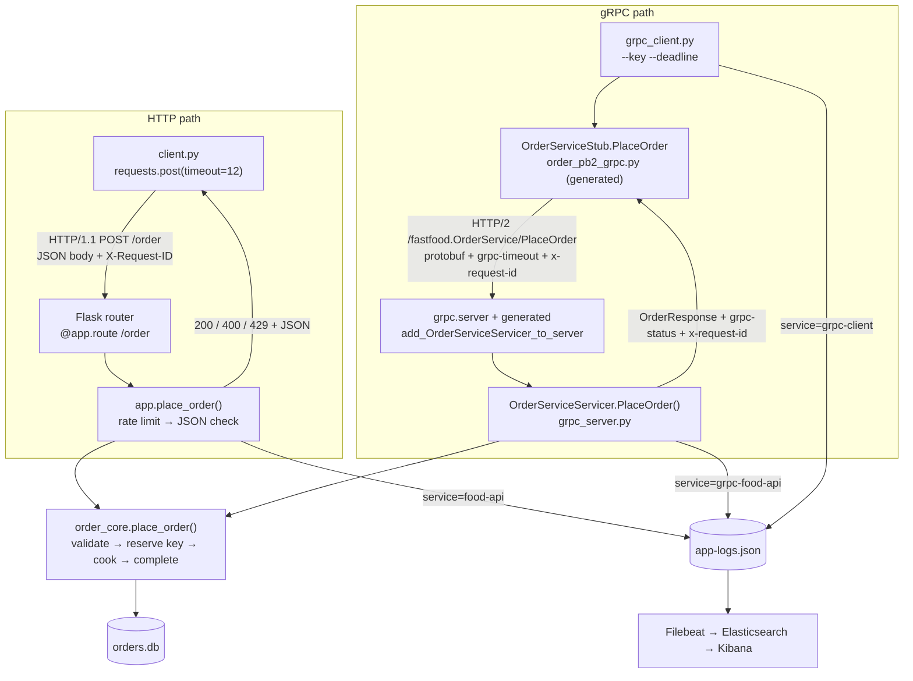

### B.6 Logs and trace correlation across the gRPC boundary

The A1 logging setup is unchanged: JSON lines in `app-logs.json`, shipped by Filebeat to Elasticsearch. Every line now also carries a `trace_id` (and `channel`), next to the A1 `request_id` (the order ID).

1. The gRPC client creates a trace ID and logs `gRPC call started`.
2. It sends the ID as metadata `x-request-id`.
3. The server reads the metadata, logs `Order received` / `Order complete` with the same `trace_id`, and echoes the ID back in trailing metadata.
4. The client logs `gRPC call finished` with the result.

HTTP works the same way with the `X-Request-ID` header.

Searching Kibana for one trace ID returns the whole call across both processes:

```text
trace_id : "89542bce8ffd403fafcbcfe7de16fc35"
```

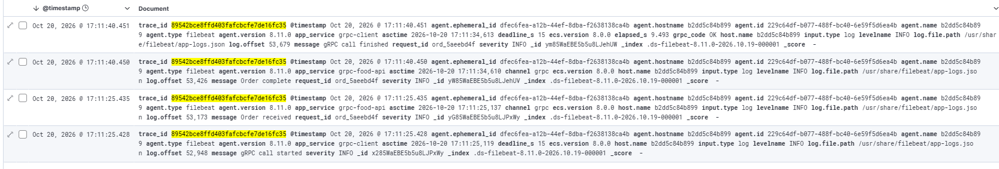

| `asctime` | `app_service` | `message` | Details |
|---|---|---|---|
| 17:11:25.119 | grpc-client | gRPC call started | deadline 15 s |
| 17:11:25.137 | grpc-food-api | Order received | `ord_5aeebd4f`, channel grpc |
| 17:11:34.610 | grpc-food-api | Order complete | `ord_5aeebd4f` |
| 17:11:34.613 | grpc-client | gRPC call finished | `grpc_code OK`, 9.49 s |

`asctime` is when the application wrote the line. `@timestamp` is when Filebeat shipped it, about 0.3 s later. Filebeat renames `service` to `app_service`.

---

## Part C — Extending the metrics

### C.1 Audit of the A1 metrics

| A1 metric | Type | Useful? | Problem / gap | A2 action |
|---|---|---|---|---|
| `orders_placed_total` | Counter | Yes — throughput | Counts only orders that start cooking; rejections, replays and failures are invisible, so there is no error rate. | Kept; calls and errors now come from `http_requests_total` |
| `orders_waiting` | Gauge | Yes — kitchen queue | — | Kept; mirrored for gRPC |
| `cook_time_seconds` | Histogram | Yes — kitchen p50/p95 | Covers cooking only, not the whole request | Kept; mirrored for gRPC; end-to-end duration added |
| `cook_time_summary_seconds` | Summary | Partly | Duplicates the histogram's `_sum`/`_count`; summary quantiles cannot be aggregated | Kept only so the A1 dashboard still works |
| `demo_requests_total{request_id}` | Counter | **No** | Left over from the A1 cardinality experiment: one series per order (unbounded label) | **Removed** |
| `node_*` | Mixed | Yes — host | — | Kept |
| *Calls and errors by method and status* | — | Missing | Neither protocol recorded outcomes | **Added** |
| *gRPC service metrics* | — | Missing | New process | **Added** |
| *End-to-end request duration* | — | Missing | Only kitchen time existed | **Added** |
| *Idempotent replays* | — | Missing | Retries answered from the store looked like normal `200`s | **Added** (other missing metric) |

### C.2 New metrics

All metrics are measured **at the server**. The Python callers do not expose metrics.

| Metric | Purpose | Type | Unit | Labels | Code location | Query |
|---|---|---|---|---|---|---|
| `http_requests_total` | HTTP calls and errors by method, route and status | Counter | requests | `method`, `route`, `status` | `app.py:38` defined; `:104` incremented in `finish_request()` | `sum by (method, route, status) (rate(http_requests_total[5m]))` |
| `http_request_duration_seconds` | End-to-end HTTP handling time | Histogram | seconds | `method`, `route` | `app.py:40`; `:105` observed in `finish_request()` | `histogram_quantile(0.95, sum by (le) (rate(http_request_duration_seconds_bucket{route="/order"}[5m])))` |
| `grpc_server_handled_total` | gRPC calls and errors by RPC method and status | Counter | calls | `grpc_method`, `grpc_code` | `grpc_server.py:37`; `:99` incremented in `PlaceOrder()` `finally` | `sum by (grpc_method, grpc_code) (rate(grpc_server_handled_total[5m]))` |
| `grpc_server_handling_seconds` | End-to-end gRPC handling time | Histogram | seconds | `grpc_method` | `grpc_server.py:39`; `:100` observed in `PlaceOrder()` `finally` | `histogram_quantile(0.95, sum by (le) (rate(grpc_server_handling_seconds_bucket{grpc_method="PlaceOrder"}[5m])))` |
| `grpc_orders_waiting` | gRPC orders in flight (being cooked) | Gauge | orders | — | `grpc_server.py:31`; `order_core.py:189`/`:200` inc/dec | `grpc_orders_waiting` |
| `grpc_orders_placed_total` | New gRPC orders (throughput) | Counter | orders | — | `grpc_server.py:30`; `order_core.py:188` | `rate(grpc_orders_placed_total[5m])` |
| `grpc_cook_time_seconds` | gRPC kitchen time, comparable with A1's `cook_time_seconds` | Histogram | seconds | — | `grpc_server.py:32`; `order_core.py:199` | `histogram_quantile(0.95, sum by (le) (rate(grpc_cook_time_seconds_bucket[5m])))` |
| `idempotent_replays_total` | Requests answered from the store instead of cooking | Counter | requests | `channel` (`http` / `grpc`) | `order_core.py:48`; `:183` | `sum by (channel) (rate(idempotent_replays_total[5m]))` |

**Labels are bounded.** No metric uses a user, request, order or trace ID.

| Label | Possible values |
|---|---|
| `method` | HTTP verbs |
| `route` | The Flask route rule (`/order`, or `unmatched`) — never the raw path |
| `status` | HTTP status codes |
| `grpc_method` | One per RPC |
| `grpc_code` | The 17 canonical gRPC codes |
| `channel` | `http` or `grpc` |

The test `test_metrics_have_status_labels_and_no_id_labels` checks that no `request_id` label appears. Expected status and code combinations are created at 0 when each server starts, so `rate()` also sees the very first error.

**Duration buckets** (both new histograms): `0.005, 0.01, 0.05, 0.1, 0.5, 1, 2.5, 5, 6, 7, 8, 9, 10, 15, 20, 30` s. Fast outcomes (validation errors, replays, `429`s) land in the millisecond buckets. Normal orders land in the 1-second steps between 5 and 10 s, where p50 and p95 matter. The 15–30 s buckets catch the "slow kitchen" fault from A1 E.1.

### C.3 Prometheus scraping

`prometheus.yml` scrapes every 5 s:

| Job | Target |
|---|---|
| `fast-food-api` | `host.docker.internal:5000` |
| `grpc-food-api` | `host.docker.internal:5001` |
| `node-exporter` | `node-exporter:9100` |

All three targets are up:

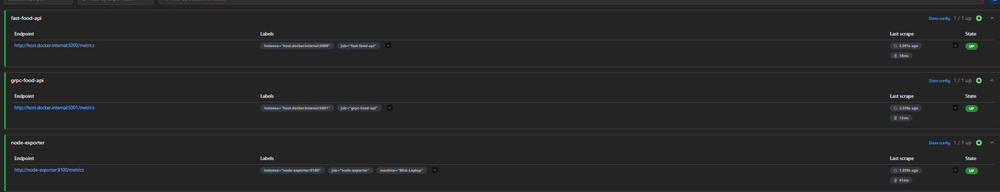

### C.4 Grafana: gRPC beside HTTP

Dashboard: [`dashboards/fast_food_api_a2.json`](./dashboards/fast_food_api_a2.json). Every rate and percentile uses a **5-minute window**. The screenshot was taken after `py traffic_generator.py --rounds 5`, which ran from about 17:08 to 17:14.

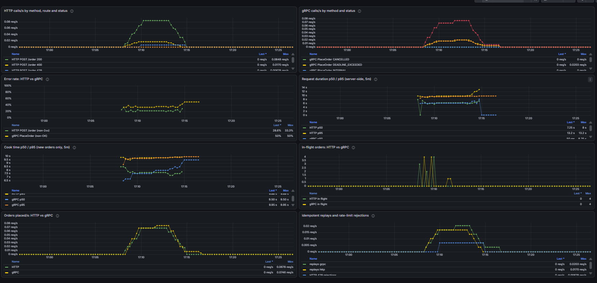

| Panel | Rubric item | Reading during the run (17:09–17:14) |
|---|---|---|
| HTTP calls/s by method, route, status | Calls and error rate by method and status | `200` up to 0.085 req/s; `400` up to 0.017; `429` 0.007 |
| gRPC calls/s by method and status | Calls and error rate by RPC method and status | `OK` up to about 0.075 req/s; `INVALID_ARGUMENT` and `DEADLINE_EXCEEDED` up to 0.020 each |
| Error rate: HTTP vs gRPC | Error rate | HTTP about 20–28 %; gRPC about 33 % |
| Request duration p50 / p95 | Duration histogram, p50 and p95 | HTTP p50 about 7.3 s, p95 about 9.5–10 s; gRPC p50 about 6 s |
| Cook time p50 / p95 | (A1 metric, both protocols) | p50 about 7–8.5 s, p95 about 9.7–9.95 s for both |
| In-flight orders | In-flight calls | Peaks of 3–4 per protocol |
| Orders placed/s | Throughput | HTTP up to 0.068, gRPC up to 0.075 orders/s |
| Idempotent replays and 429s | Other missing metric | Replays up to 0.017 (HTTP) and 0.020 (gRPC) per s |

**Reading the numbers.**

- **Error rates match the designed traffic mix.** Each round sends 5 HTTP calls with 1 deliberate `400` (20 %), plus a final burst that adds 2 `429`s. Each round also sends 6 gRPC calls with 1 `INVALID_ARGUMENT` and 1 `DEADLINE_EXCEEDED` (2/6 = 33 %).
- **gRPC request-duration p50 (about 6 s) is lower than its cook-time p50 (about 7–8 s).** Request duration includes every call, and the instant validation failures and replays pull the median down. Cook time includes new orders only.
- **HTTP p95 briefly reaches 13.2 s at 17:14**, although cooking never exceeds 10 s. A few requests took just over 10 s end to end (cook time plus database and thread overhead). That puts them in the `(10, 15]` bucket, and `histogram_quantile` assumes values are spread evenly inside a bucket, so it reports about 13 s. This shows the limit of bucket resolution; adding an 11 s bucket would tighten the estimate.
- **After about 17:15 traffic had stopped.** The 5-minute windows held only a few leftover calls, so the gRPC error rate shows 50 % and gRPC p50 drops to 50 ms. Those values describe the tail of the window, not the service.
- **gRPC in flight peaks at 4.** The generator sends 3 normal orders plus 1 with a 2 s deadline. The server keeps cooking that order after the client gives up, so it is still counted.

**In-flight calls, not message size.**

- Message size carries almost no information here. Every request is one short key string and every response is two short strings, so sizes are nearly constant.
- In-flight count is useful. Each order holds a worker thread for 5–10 s, and the gRPC server has 10 workers, so a gauge sitting at 10 means new calls are queueing for a thread — the gRPC equivalent of the kitchen backing up.

**Duration is measured at the server.** It covers the handler (rate limiting, validation, store and kitchen), but not network time, client-side waiting, or time queued before a worker thread picks the call up.

### C.5 Generating repeatable traffic

`traffic_generator.py` uses fresh keys every round, so each run produces the same mix:

| Per round | HTTP | gRPC |
|---|---|---|
| New orders (sent at once) | 3 × `200` | 3 × `OK` |
| Repeat of an earlier key | 1 × `200` (replay) | 1 × `OK` (replay) |
| Invalid input | 1 × `400` | 1 × `INVALID_ARGUMENT` |
| Deadline too short | — | 1 × `DEADLINE_EXCEEDED` |

After the last round, 7 HTTP calls at once give 5 × `200` + 2 × `429`. Each round starts at least 10.5 s after the previous one, so the HTTP rate limit only rejects the deliberate burst.

The other scripts are repeatable too: `py client.py demo`, `py client.py ratelimit` and `py grpc_client.py --demo` all use fresh keys.

---

## References and reused work

- **Assignment 1 project:** Flask app structure, JSON logging setup, A1 metric definitions, Docker Compose, Prometheus and Filebeat configuration.
- **Course gRPC workshop** (`labs/week1-midnight-launch/GRPC-WORKSHOP.md`): reference for the `.proto` layout, the code generation command, and the stub/servicer structure.
- **OpenAPI Specification 3.0.3:** https://spec.openapis.org/oas/v3.0.3
- **gRPC status codes:** https://grpc.io/docs/guides/status-codes/
- **gRPC Python — deadlines and metadata:** https://grpc.io/docs/languages/python/
- **Prometheus histograms and `histogram_quantile`:** https://prometheus.io/docs/practices/histograms/
- **Libraries:** Flask, prometheus-client, python-json-logger, grpcio / grpcio-tools, requests, pytest, jsonschema, PyYAML.
- **AI assistance:** [Declare here any use of AI tools, in the form required by the course academic-integrity policy.]
